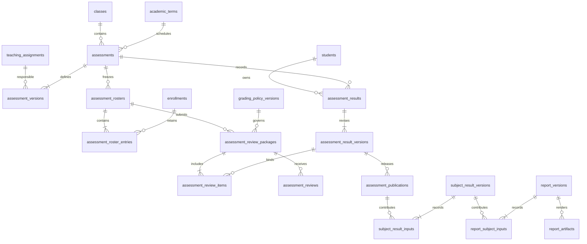

# Phase 4 data design and test plan

Prepared 29 October 2026 from the current checkout. This is the 4.0 design proposal, not an applied schema or an implementation-completion claim. Read [the academic decisions](PHASE_4_ACADEMIC_DECISIONS.md) for product rules and [the implementation plan](PHASE_4_PLAN.md) for sequence. No hosted database was inspected or changed for this design.

## What the current code gives us

Implementation update, 4 November. Migrations 022–029 are applied. Migration 028 implements the proposed review-package concept as `assessment_submissions`, `assessment_submission_entries` and `assessment_review_decisions`. Entries reference exact retained mark versions and snapshot placements. Definitions retain the authorised scale. Approval and return bind to one complete submission. Reporting policy configuration and publication remain pending, so these raw review packages have no approved reporting-policy binding yet. The proposed relationships below remain the broader Phase 4 design.

Migration 029 starts the proposed `grading_policies` and `grading_policy_versions` model with draft scope, dates, source references and school-rule notes. Its current fields gather the policy without defining calculation methods. Approved versions, unambiguous applicability, retirement and executable configuration remain later work after the school supplies its rules.

| Existing source | Reuse and important limit |
| --- | --- |
| `supabase/migrations/202610010003_academic_structure.sql` | Years, terms, grades, subjects and classes. Terms have a school/year and dates; a term is not a grading formula. |
| `202610010004_registers.sql`, `202610010009_enrollment_lifecycle.sql` | Student placement, inclusive dates, transfer/withdrawal history and overlap protection. A closed placement can still be eligible on an earlier assessment date. |
| `202610010005_teaching_assignments.sql`, `202610040014_teaching_assignment_lifecycle.sql` | Dated class/subject/teacher responsibility. A later replacement must not inherit earlier mark-editing authority. |
| `202610020010_register_membership_links.sql` | Active membership/role helpers, linked teachers/students/guardians, explicit guardian access and school-local date. |
| `202610070017_role_read_models.sql` | Narrow role-specific projections with explicit selected-child validation. Reuse the pattern, not current-week eligibility. |
| `202610080019_homework.sql` | School lock, rechecked permissions, expected versions, audited RPC writes and bounded readers. Its publication-date audience is wrong for academic results. |
| `src/lib/auth-context.ts`, `src/lib/permissions.ts`, `src/lib/portal-data.ts` | Verified request context and portal actor. Keep role modes as requested context, never authority. |
| `src/app/dashboard/documents/[id]/download/route.ts` | Authenticated private download, no-store headers and PDF integrity checks. Personal reports need their own publication-aware Storage policy. |
| `tests/homework-database.test.ts`, `tests/helpers/storage-stub.ts` | Disposable PGlite database, ordered migrations, simulated authenticated roles and fictional two-school fixtures. This is not hosted Storage or concurrent-session evidence. |

The design started from migrations 001–021. Migrations 022–025 now implement definitions, draft capture, placement amendments and historical correction grants. The diagram below retains the original proposal.

## Proposed relationships

The diagram groups proposed relationships. In the implemented draft model, the school/assessment/learner roster entry anchors append-only `assessment_mark_versions`. A version counter and `assessment_roster_amendments` retain placement changes. The separate result identity/current-version pointer shown in the design is not an installed table. Review and publication must bind to exact retained versions.

Grants are omitted from the diagram: they reference existing `school_memberships` and the precise assessment or year/term/class/subject scope. The sections below define their purpose.

## Core records and constraints

### Assessment setup — build first

- `assessments`: stable school-owned identity, class/year/subject, current definition pointer and optimistic `record_version`. No hard deletion after a roster exists.
- `assessment_versions`: immutable definition revisions containing title, instructions, term, effective date, responsible assignment and authorised scale. Store minimum, maximum and allowed decimal precision, scale authoriser and timestamp. A teacher can prepare a proposal; only Admin authorises its scale. Editing scale fields removes the old authorisation from the new version.
- Assignment/class/year/subject must agree, not merely belong to the same school. The term must belong to that year; the effective date must fit the term, year and responsible assignment. A period-based assessment still has the agreed single effective eligibility date.
- A class/year/subject change after freezing is not an ordinary edit. Reject it; create a separate assessment rather than moving historical marks. Date/scale/roster amendments use the Admin workflow and invalidate affected versions.
- Future definitions are allowed. Freeze/capture is not allowed before the effective school-local date. Admin is subject to the same rule.
- Do not require a completed grading formula to save a definition or an authorised scale. Keep official calculation/publication disabled without the applicable approved policy.

### Frozen eligibility and marks — second slice

- `assessment_rosters`: immutable roster revisions linked to the exact assessment definition, freeze/amend actor, time and reason.
- `assessment_roster_entries`: one learner per roster revision, existing enrolment ID, captured placement dates/version and class/year. Preserve removed entries in previous revisions. Store only the historical fields needed to establish eligibility, not full personal profiles.
- `assessment_results`: stable unique `(school_id, assessment_id, student_id)` identity, current result-version pointer. This identity survives roster amendments; a learner does not get duplicate results because the roster version changed.
- `assessment_result_versions`: immutable score/state revisions linked to the applicable roster entry and definition. Store decimal score, state, actor and correction reference; staff reasons remain staff-only. `scored` requires a valid score; all other states require a null score. Zero is a real scored value. Reject NaN/infinity, excess precision and out-of-scale numbers.
- An unenrolled late entrant is not silently inserted by save. Admin must amend eligibility explicitly. Revoked guardian grants do not alter historical result ownership, only current access.
- A frozen roster records evidence. Later date changes to an enrolment do not silently recalculate it. If staff discover wrong historical eligibility, use the amendment workflow and audit it.

### Policy versions and scoped grants

- `grading_policies` plus `grading_policy_versions`: school/year/grade/subject applicability, effective period, source reference, approval and validated method configuration. Expand a phase-wide policy into explicit grade applicability rather than matching grade names at runtime. Prevent ambiguous effective applicability; retain old versions for historical references.
- Policy retirement stops new adoption, not historical evidence. Corrections must explicitly identify the applicable retained or replacement policy version. Approving a new policy alone does not recalculate earlier results.
- Use typed numeric fields/validated configuration for supported methods. No SQL or JavaScript formulas supplied by users. Formula-specific tables/configuration wait for the first actual school policy; do not invent weights now.
- `assessment_reviewer_grants`: membership, year, term, class, subject, validity dates, issuer/revocation. Both teacher and Admin need a matching grant to review.
- `assessment_correction_grants`: teacher membership, named assessment and optional named learner, validity dates, reason and issuer/revocation. This does not grant review/publication.
- `academic_output_review_grants`: Admin membership, year, reporting period and class. Annual scope is explicit; a null term must not accidentally mean all periods.
- Every grant uses composite same-school references. Revocation is retained, not deletion. User IDs and membership IDs are distinct; resolve the caller through the existing helpers.

### Review packages and learner publications

- `assessment_review_packages`: immutable submission for a complete roster revision and definition/policy version, based on the current aggregate version.
- `assessment_review_items`: exact result-version reference for each eligible learner and a changed/unchanged indicator for correction packages. No Missing entries. Validate package completeness in the database, not by trusting the visible form page.
- `assessment_reviews`: append-only approve/return/invalidate decisions, actor, grant evidence and package ID. Self-review remains visible in the audit. Approval belongs to the submitted content, never a mutable assessment ID alone.
- `assessment_publications`: learner-safe immutable release payload tied to result version, package and approval, with publication/withdrawal metadata. At most one current release per assessment/learner. Store no staff comments or correction allegations in the learner-facing payload.
- Use separate row/column exposure for learner releases and staff revisions. RLS is row-level: it cannot by itself hide a staff-only reason column in an otherwise readable row.
- Initial publication releases the eligible roster atomically. A correction package releases changed eligible versions only. Unchanged current publications do not point to a newly invalid package and do not disappear because another learner changes.
- Review can prepare raw work before formula policy is available, but official publication cannot. Bind any later adopted reporting policy to a fresh package and review rather than attaching it silently to an old approval.

### Subject results and reports — later Phase 4 slices

- `subject_results` / `subject_result_versions`: stable learner/subject/period identity and immutable calculated snapshots. Include policy version, method version, completeness and explicit input references.
- `subject_result_inputs`: typed links to exact assessment publications; annual calculation may use explicit term-result versions. Prevent cycles and reject sources belonging to another learner, school, subject or period.
- `report_cards` / `report_versions`: learner/year/period identity and immutable issued content, policy references, comments, issue/revision details and source versions. Preserve required display values so later school/subject name changes cannot silently rewrite issued reports.
- `report_subject_inputs`: typed links to exact subject-result versions. No generic unvalidated `(table_name, record_id)` dependency store.
- Output review and publication records bind exact subject/report versions with the separate Admin output-review grant. Final names may be split by output type to keep foreign keys enforceable; no shared workflow framework is required.
- `report_artifacts`: private path, exact report version, checksum, size and generation state. A ready PDF is not automatically a published report. Generation failure leaves the report/artifact unavailable as appropriate, never resurrects a withdrawn version.
- Report availability is determined by current publication plus current caller access on every request, including direct Storage download. No public bucket or reusable signed URL for reports. Bytes already delivered cannot be recalled.

These later records explain dependencies now; do not create all of them in the assessment-setup migration.

## Integrity and access enforcement

Use composite `(id, school_id)` foreign keys everywhere and stronger tuple constraints where ownership alone is insufficient. Existing classes expose `(id, school_id, academic_year_id)`; migration 019 adds an assignment identity tuple. New child references must also prove matching learner, assessment and revision. Add needed unique keys in new migrations, never by rewriting old files. Validate term/year/subject agreement in triggers or checked RPCs where the existing tuple is insufficient.

New tables use RLS and restricted grants. Staff version/audit tables are not readable by learners. Public mutation RPCs use the existing audited SQL pattern: fixed empty search path, schema-qualified names, no anonymous execute, no arbitrary actor parameter, and fresh identity/role/scope checks. SECURITY DEFINER is a controlled database boundary with explicit checks, not permission to bypass access using elevated app credentials. Direct writes to transition/version tables remain denied.

Learner readers require the existing linked Student or selected Guardian child context and return only that learner's current releases. Teacher scope must never become Guardian access. Direct API policies must independently enforce current ownership/grants even without a UI mode. Bounded readers perform authorisation before pagination and return minimal fields.

Reuse the current school-row lock order for related writes: authenticate, lock school, recheck authority, lock assessment/output, validate expected version, write revisions/dependencies/audit, commit. Existing membership, guardian-link, enrolment and assignment changes already participate in that school-lock pattern. New grant revocation must do so too. Keep transactions short; no PDF rendering or network requests while locks are held. Measure contention before changing the established lock strategy.

## Correction transaction and dependency invalidation

1. Validate identity, current editing authority, reason and expected aggregate version.
2. Acquire locks in the same order as publication/grant changes and recheck authorisation/version.
3. Record Begin correction and append the new draft result version; preserve the old record.
4. Withdraw the affected current learner release. Invalidate pending package approval for changed content.
5. Follow typed dependency links to subject outputs, annual outputs and report versions. Mark all affected current publications unavailable in this transaction, even if recomputation may produce the same number.
6. Retain artifact metadata but make Storage/HTML/download authorisation reject invalidated report versions immediately. Roll back everything if any required database step fails.
7. After commit, show a neutral unavailable message. Later review, calculation and PDF generation cannot restore visibility automatically; Admin publishes explicitly.

Use the same school lock for output creation/publication so a report cannot be published concurrently from an input being withdrawn. Downloads recheck eligibility at request time; a response already authorised/in flight cannot be retroactively recalled. Avoid cross-request caches of permissions or current publication. Independent concurrent database sessions must test both correction/publish orderings.

## File plan and implementation boundaries

The original first-slice file plan is shown below. For actual files and later slices, use the [assessment file map](ASSESSMENTS.md#files-and-responsibilities).

| File | Responsibility |
| --- | --- |
| `src/lib/assessment-validation.ts` | Validated fields and scale/date input, not database authority. Reuse existing Zod dependency. |
| `src/lib/assessment-data.ts` | Server-only bounded authorised assessment readers using existing Supabase client. |
| `src/app/dashboard/assessments/actions.ts` | Verified context, parse input, call checked RPC, map errors and revalidate. Follow homework actions without copying its eligibility rule. |
| `src/components/assessment-panel.tsx`, `assessment-form.tsx` | Existing panel/form patterns, explicit permissions and planning/scale status. |
| `src/app/dashboard/page.tsx`, existing shell/navigation helpers | One assessment view integrated with existing mode preservation. Do not add a parallel dashboard/router. |
| Migration 022 | Assessment definitions, scale authorisation, scoped readers and writers. |
| `tests/assessment-validation.test.ts`, `assessment-actions.test.ts`, `assessment-database.test.ts` | Bounds, caller/action behaviour, actual SQL authorisation and relationships. Names provisional. |

Later marks/review/results/report files follow the existing Phase 4 plan. No new dependency, environment variable, service-role key or cloud resource is required for assessment setup. PDF library choice waits until report work. Read the installed Next.js documentation before application changes.

## Fixture plan — not a hosted seed script

Local database tests may create isolated disposable fictional A/B records, following the existing tests; they must never connect to hosted Supabase. Use school-local dates relative to the test clock, plus explicit past/future boundary fixtures, so a test does not stop working when 2026 ends. Test midnight across school timezones separately.

Hosted checks reuse the existing School A/B accounts, people, classes, enrolments and guardian grants. Before any fixture write, inventory IDs and eligibility read-only. Previous notes identify ST-003 and the 2026 class labelled 12A - 2026; they are historical pointers, not verified current data. Preserve 2027 planning records. Do not create another learner or school to make a test pass. School B's exact current usable records are not verified in this task.

Choose existing participants for Admin, assigned teacher, teacher without reviewer grant, authorised reviewer, Student, linked Guardian and Teacher/Guardian. Reuse users for multiple test roles where suitable; do not assume their roles/grants or change them silently. Use a clearly labelled fictional assessment with a temporary explicitly fictional scale; never describe test weights as approved school policy. New assessments/grants and consequential lifecycle changes need a concrete fixture plan before hosted execution. If required School B structure or an eligible current placement is absent, report the gap rather than moving existing records or weakening date rules.

## Acceptance matrix

Every item below is planned and unchecked; no new tests were run for this document.

| ID | Scenario | Expected evidence |
| --- | --- | --- |
| P4-D01 | Assessment uses another school's class/term/assignment or mismatched year/subject | SQL rejects direct and RPC writes; no partial audit/data mutation. |
| P4-D02 | Future planning versus capture; timezone/effective-date boundaries | Planning succeeds within scope, early freeze/capture denied including Admin. |
| P4-D03 | Teacher proposes scale; Admin authorises; scale changed later | Teacher cannot authorise; changed version loses old authorisation; invalid precision/bounds denied. |
| P4-D04 | Freeze, transfer/withdrawal and later enrolment edit | Frozen eligibility retained, late joiner excluded, Admin amendment versioned. |
| P4-D05 | Partial-page save and simultaneous/stale saves | Untouched rows preserved; stale request rejected; no automatic zero. |
| P4-D06 | Missing, absent, exempt and scored zero | Correct distinct states; Missing blocks submission; absent/exempt have no invented percentage. |
| P4-D07 | No reviewer grant, wrong scope, expired/revoked grant, self-review | Denials enforced in SQL; valid self-review audited; open stale form cannot approve. |
| P4-D08 | Approve exact package, edit then publish old approval | Stale publication denied; new review required. Completed approval survives later grant expiry unless invalidated. |
| P4-D09 | Correct learner A with learner B unchanged | A and its dependent outputs hidden atomically; B stays visible; old PDF/HTML/direct Storage denied. |
| P4-D10 | Concurrent correction and report generation/publication; forced transaction failure | No mixed visibility or partially committed correction. Use independent real PostgreSQL sessions, not only one PGlite connection. |
| P4-D11 | Teacher replacement and historical grant | Replacement has no automatic earlier edit right; scoped grant allows only its intended operation/learners. |
| P4-D12 | Student/Guardian, explicit child, revoked grant, multi-role switching | Only permitted published learner data; no staff notes/drafts or teacher-roster-to-child access. |
| P4-D13 | Anonymous, School B and other learner direct reads/writes | Denied across RPC, table access, route and Storage. Hosted evidence separate from mocked/unit checks. |
| P4-D14 | Policy missing, overlaps, approved replacement, unsupported formula | Calculation/publication blocked appropriately; historical policy not silently replaced. |
| P4-D15 | Subject/report review, incomplete mandatory input, changed comment | Output-review grant required; incomplete report blocked; changed version requires fresh approval/publication. |
| P4-D16 | PDF failure/retry, old path, long names and multi-page report | Exact snapshot only; private access; stale artifact never becomes current; layout verified. |
| P4-D17 | Existing portal regression and performance | Mode/child context retained; no assessment history in profile menu; bounded queries; lint/types/full tests/build then scoped browser checks. |

For each implemented slice, record local SQL tests, hosted API/RLS tests and browser evidence separately in VERIFICATION.md. Never turn these design checkboxes into passes merely because a migration applies.

## Ready to start and remaining gates

The relationship proposal and test scenarios are ready for review. The first implementation slice is assessment definitions, authorised scales and staff planning UI, with no learner publication or calculation engine. Its concrete migration must be checked against the above constraints before application. The model deliberately leaves school-specific numerical policy configuration and report presentation outstanding.

No schema migration, account, fixture or application file was created by this design task. No tests/build or hosted verification ran. Actual fixture bindings remain a read-only preflight at hosted-testing time.
