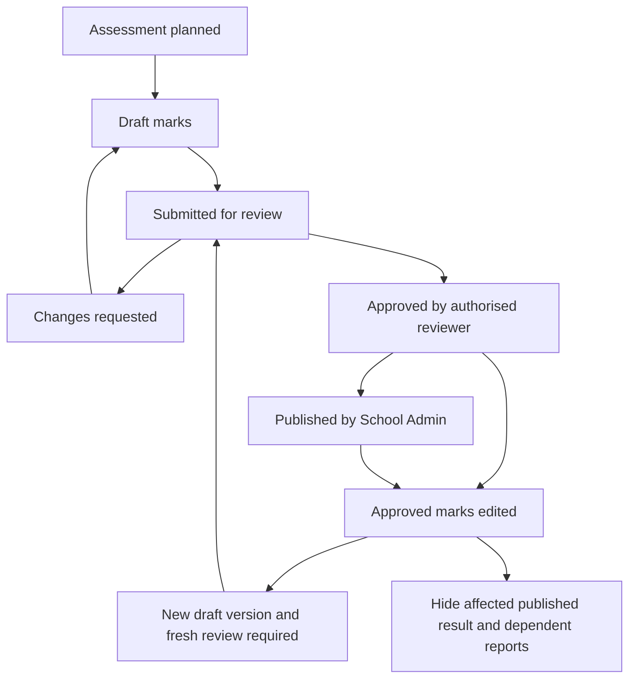

# Phase 4 preparation: academic performance

Prepared 27 October 2026; reconciled 29 October 2026. Phase 3 is signed off. The first assessment-planning slice is now implemented locally with migration 022; hosted application/acceptance remain pending. See [ASSESSMENTS.md](ASSESSMENTS.md). Later slices below remain planned.

## What we are building

Assessments, mark entry, authorised review, School Admin publication, report cards and focused performance summaries. Keep the existing single-school experience and school-aware database boundaries. Finance belongs to Phase 5. AI, automation and the deferred session-timeout work belong to Phase 6.

## Confirmed decisions

- A specifically authorised Teacher or School Admin may review marks. Being a teacher alone does not grant review permission.
- Self-review is allowed. Record who entered and reviewed each version even when it is the same person.
- Only School Admin publishes results. Review approval never publishes automatically.
- Changing an approved result requires another review. If it was published, hide the affected published result immediately. After review, School Admin must explicitly publish the corrected version again.
- Grading-policy structure and result states are agreed in [PHASE_4_ACADEMIC_DECISIONS.md](PHASE_4_ACADEMIC_DECISIONS.md). The school must still supply numerical weights, rounding, bands and absent/exempt calculation rules; do not invent defaults.
- Keep the four existing account roles. Reviewer is a scoped permission, not a fifth login role or a new authentication system.

## What we can reuse

| Existing file or area | How Phase 4 should use it |
| --- | --- |
| `src/lib/auth-context.ts`, `src/lib/permissions.ts` | Server-verified identity, active school membership and role checks. UI workspace selection never grants authority. |
| `src/lib/portal-data.ts`, `src/lib/portal-validation.ts` | Linked learner/teacher identities, explicit Guardian learner selection and role-preserving navigation. |
| `src/lib/school-date.ts` | School-local dates for academic eligibility. Preserve future-year planning without permitting ineligible daily operations. |
| `academic_years`, `academic_terms`, `grades`, `classes`, `subjects` | Existing academic structure; do not create parallel year, class or subject models. |
| `enrollments`, `teaching_assignments` | Dated learner placement and teacher responsibility, including retained transfer/replacement history. |
| `src/app/dashboard/homework/actions.ts`, `src/lib/homework-data.ts`, `src/lib/homework-validation.ts` | Examples of validation, user-scoped server actions/readers and atomic versioned workflows. Reuse the pattern, not homework's audience policy. |
| `src/components/record-search-select.tsx`, `src/lib/list-pagination.ts` | Bounded lists and searchable choices. Review permissions must scope choices before pagination. |
| `src/components/portal-shell.tsx`, `src/app/dashboard/page.tsx` | Existing role-aware shell and routing. Preserve explicit modes and Guardian child context. |
| `src/components/profile-menu.tsx` | Keep identity light; do not make every module request load assessment or report history. |
| `audit_events`, `record_history`, existing SQL migration/test patterns | Accountability and concurrency patterns. Financial/academic history must not be silently overwritten. |
| Private Supabase Storage and authenticated document downloads | Infrastructure patterns for report PDFs. The Documents library's current-class audience is not suitable for personal report access without a deliberate policy. |

The current migration files contain no assessment, result or report-card tables. New tables and policies will require additive migrations after design review. Do not edit migrations 001–021. Check the actual next available number when creating a migration.

## Decision record and remaining inputs

Read [PHASE_4_ACADEMIC_DECISIONS.md](PHASE_4_ACADEMIC_DECISIONS.md) alongside this plan. It contains the user's policy report and the permission matrix/workflow refinements finalised on 29 October. It governs academic policy; this file governs implementation order. Neither is evidence of implemented Phase 4 behaviour.

| Area | Settled planning decision | Remaining input or design work |
| --- | --- | --- |
| Grades and policy | Model Grades R–12; scoped, approved, immutable policy versions; Admin authorises scales and approves policies. | First actual school policy, score scale, precision, bands and supported formula configuration. |
| Weighting | Explicit decimal-safe term/annual calculation, versioned inputs; no default averages or inferred promotion. | School weights, formula, rounding stages, mandatory components and any promotion rules. |
| Score states | Missing, absent, exempt and scored (including zero) are distinct. Missing blocks submission/approval/publication. | School-authorised absence/exemption resolution and calculation treatment. |
| Review authority | Explicit teacher/Admin grants per school, year, term, class and subject; self-review allowed; revocation blocks new decisions. | Grant schema and denial/concurrency tests, not another product-policy decision. |
| Review/publication unit | Complete versioned assessment roster; learner versions retained; correction package identifies changes and preserves unrelated published results. | Concrete version/dependency relationships and atomic transaction design. |
| Historical eligibility | Assessment effective date; explicit freeze before capture; Admin-only roster amendments; scoped historical-correction grants. | Reuse and validate existing enrolment/assignment constraints. |
| Report visibility | Own/explicitly granted learner only; private snapshot HTML then PDF; separate Admin output-review grant and Admin publication. | School's final layout, comment/signature fields and labels. |
| Completeness | No Missing override; official results require approved policy and all mandatory inputs. Absent/exempt are not automatic zero. | Actual policy-required components and allowed non-score release rules. |
| Correction/withdrawal | Authorised Begin correction atomically hides affected outputs; only Admin withdraws without replacement; reasons and fresh review/publication required. | Dependency graph, protected download design and tests. |

We can design and implement assessment setup and raw entry using an authorised scale before full calculation policy is available. Official calculation/publication must stay unavailable until the applicable school-approved policy is supplied. Do not treat fictional test values as school policy.

## Permission and workflow contract

The authoritative action matrix and detailed rules are in [decision record Section 10](PHASE_4_ACADEMIC_DECISIONS.md#10-final-workflow-details-and-permission-matrix--29-october-2026). Key boundaries:

- Admin controls policy approval, reviewer/correction grants, frozen-roster amendments and withdrawal. Admin still needs an explicit grant to review.
- Ordinary teacher entry needs the retained assignment to cover assessment eligibility and current access. Future planning is allowed; future mark capture is not. Historical editing needs a scoped grant when ordinary entry authority has ended.
- Explicitly freeze the dated roster before capture; later enrolment changes cannot silently rewrite it.
- Initial review covers the complete roster. Correction review covers a new complete package with changed learner versions identified; unrelated published results remain accessible.
- Completed approval survives later grant expiry/revocation unless deliberately invalidated. Every new action rechecks current authority and expected versions.
- Subject-term results and reports have separate version-specific Admin output review and deliberate Admin publication. Self-review is allowed, not automatic.
- Preserve historical evidence; invalidate all affected current outputs and downloads atomically before asynchronous recalculation or PDF work.

## Proposed workflow

This is the proposed state model, not implemented database states. Approval belongs to an exact version. An edit and its visibility invalidation must be one atomic transaction. A stale approval or publish request must never publish a different version. Old versions remain available to authorised staff for audit; hiding is not deletion. Previously downloaded PDFs cannot be recalled from a user's device.

## Implementation sequence

### 4.0 — Agree the contract

- [x] Reconcile reviewer scope, eligibility, roster/publication unit and correction decisions with the user's report (29 October).
- [x] Write the role/action matrix and finalise freeze, correction, policy approval and report-review rules (decision record Section 10).
- [x] Draw proposed data relationships and map reusable constraints in [PHASE_4_DATA_DESIGN.md](PHASE_4_DATA_DESIGN.md) (29 October; design only).
- [x] Define the fictional fixture roles/scenarios and acceptance matrix in the data design; no hosted fixtures created.
- [ ] Bind the hosted fixture plan to verified existing School A/B IDs and current eligibility before hosted tests. Do not create duplicates or alter planning records to make tests pass.

Expected result: a concrete schema/workflow proposal ready for implementation approval, with outstanding school numerical policies and report presentation clearly separated.

### 4.1 — Assessment setup

- [x] Add school-owned assessment definitions linked to existing class, subject, academic year and term where applicable.
- [x] Store assessment dates, score scale and responsible assignment using the agreed rules. Validate same-school relationships at the database boundary.
- [x] Let Admin prepare future assessments. Teachers only manage assessments within their agreed assignment scope.
- [x] Build a small assessment list/form using existing dashboard patterns, bounded pagination and scoped searches.
- [x] Test date boundaries, malformed scales, cross-school links and denied writes before hosted use.

Implemented files: `src/lib/assessment-validation.ts`, `src/lib/assessment-data.ts`, `src/app/dashboard/assessments/actions.ts`, `src/components/assessment-panel.tsx`, `src/components/assessment-form.tsx`. Migration 022, focused action/database tests and staff navigation coverage are present. Hosted migration and browser/API checks remain pending; see ASSESSMENTS.md. No roster or marks workflow is implemented.

### 4.2 — Mark entry and retained learner history

3 November 2026. Initial freeze and raw draft capture are implemented locally in migration 023. Hosted verification is deferred. The tester confirmed migration 023. Migration 024 implements Admin amendments to placement membership/evidence on a frozen draft against its existing date and scale. Historical teacher correction grants and changes to the frozen date or scale remain open.

- [x] Resolve the eligible learner roster from the agreed assessment-date rule and retain the relevant enrolment references.
- [x] Add result records with unique assessment/learner ownership, score validation and explicit non-score status using the agreed distinct score states.
- [ ] Support draft entry, corrections and bounded roster pages. Saving one page must not erase untouched learners.
- [x] Use an atomic RPC with an expected version, fresh permissions and audit entries. Reject stale edits without silent overwrites.
- [ ] Keep all drafts inaccessible to Student/Guardian sessions through both UI and direct API requests.

Proposed files: `src/lib/marks-validation.ts`, `src/lib/marks-data.ts`, `src/app/dashboard/marks/actions.ts`, `src/components/marks-panel.tsx`, `src/components/marks-form.tsx`, plus migrations and tests. Reuse the server-action/RPC pattern; do not send elevated credentials to the application.

### 4.3 — Review and School Admin publication

- [ ] Implement explicit reviewer grants within the agreed school/class/subject/term scope.
- [ ] Add submission, return-with-reason and approval against a specific result/batch version. Self-review is allowed and audited.
- [ ] Restrict publication to active School Admin membership in the same school and to the currently approved version.
- [ ] On correction, atomically withdraw affected learner-visible results and dependent report visibility, reset approval and retain history.
- [ ] Test simultaneous entry/review/publication, reviewer revocation, teacher replacement and invalidated approvals.

Keep review/publication operations beside the marks feature unless they grow enough to justify a separate module. UI buttons are convenience; SQL must reject unauthorized transitions.

### 4.4 — Learner and Guardian results

- [ ] Add read-only results within the existing workspaces, showing only published results belonging to the linked learner.
- [ ] Require explicit Guardian child selection and current access grants. Teacher roster access must not become Guardian access.
- [ ] Preserve past results across class transfers according to the agreed ownership policy; do not copy Documents' current-class rules.
- [ ] Distinguish no published results, withdrawn/correcting results and a failed load without disclosing staff-only marks.
- [ ] Test anonymous, other-learner, revoked-grant and cross-school requests through ordinary authenticated sessions.

Reuse the portal actor and navigation helpers. Add a results view to the existing shell only after its read policy is ready.

### 4.5 — Report cards

- [ ] Approve one sample report layout and exact calculation rules before building generation.
- [ ] Produce a versioned report snapshot from approved/published data; store the policy version and the source result versions used.
- [ ] Render an HTML report first. Then evaluate PDF generation with the existing dependency list; add a library only if justified and approved.
- [ ] Keep PDFs private with per-learner authorization on every new download request. Do not expose reports as school-wide documents or reusable public URLs.
- [ ] Add explicit Admin output-review grants and version-specific review before report publication.
- [ ] Hide old report downloads when an underlying published result is corrected, and require deliberate publication of the new report version.
- [ ] Test PDF content, rounding, page breaks, long names, incomplete data, repeated generation and stale report access.

Proposed files: `src/lib/report-data.ts`, `src/components/report-card.tsx`, and a protected report-download route following the existing document-route pattern. Final storage model and route naming depend on the report design.

### 4.6 — Focused summaries and acceptance

- [ ] Add only agreed subject/term performance summaries, calculated from the same versioned grading policy as the report.
- [ ] Scope staff summaries to authorised responsibilities and learner summaries to published results. Do not introduce ranking or predictive AI by assumption.
- [ ] Check query counts, database indexes, bounded lists and representative school-size behavior.
- [ ] Run lint, TypeScript, focused tests, the full suite and production build.
- [ ] Complete ordinary-session School A/B denied reads and writes, independent concurrent saves, role switching, historical placement and report downloads.
- [ ] Review the completed workflow together before Phase 4 sign-off.

## Database and security requirements for every slice

- School ownership on new academic records; composite relationships must reject foreign-school references independently of UI validation.
- Reuse Auth users, memberships, people and existing academic IDs. No new login system or duplicate student tables.
- Enforce score bounds, allowed transitions, reviewer scope, publication permission and concurrency in PostgreSQL as well as validating form input.
- Keep future-year planning separate from result eligibility and publication. Preserve historical enrolments and assignments.
- Use decimal-safe calculation and a versioned policy once rounding/weighting is decided; the browser must not be the authority for totals.
- Recheck permissions on every mutation and sensitive read. No cross-request authorization cache.
- Audit the acting user, action, affected version and agreed correction/review reason without logging credentials or full learner records.
- Keep correction visibility consistent across results, summaries, cached artifacts and PDFs. Avoid partial publication if one part of the transaction fails.
- Use only fictional data while testing. All existing migrations stay intact.

## Deferred session controls — Phase 6

The user explicitly postponed this work on 27 October. Do not implement it in Phase 4.

Proposals to revisit: 30-minute inactivity timeout, a warning two minutes beforehand, a Stay signed in action, a 12-hour maximum session, shared activity/logout across tabs, wake-from-sleep checks and protection against silent loss of unsaved work. These durations are not approved settings.

Before implementation, confirm role-specific policy, hosted Supabase plan/settings, server-enforced expiry and browser warning behavior. A browser timer alone is not an authorization boundary, and access-token expiry is not the same as session expiry. Leave existing authentication behavior unchanged until this work is explicitly resumed.
